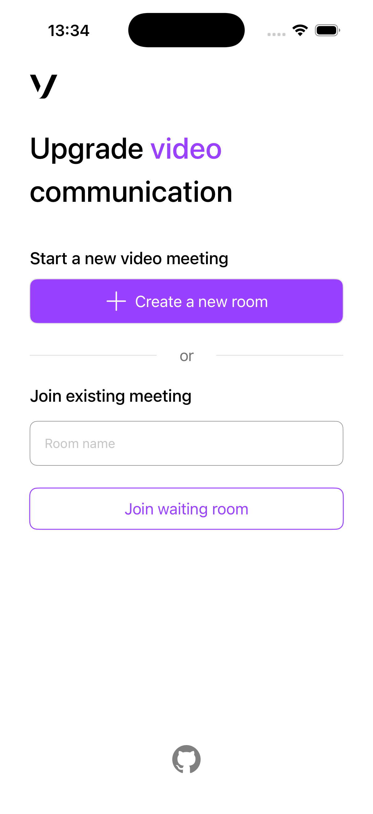
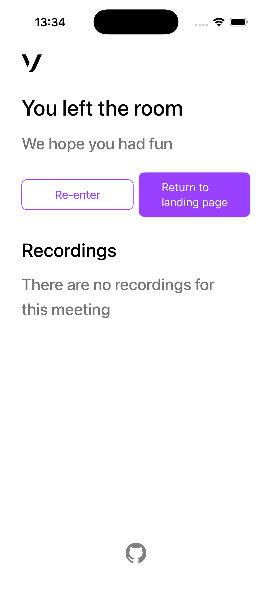
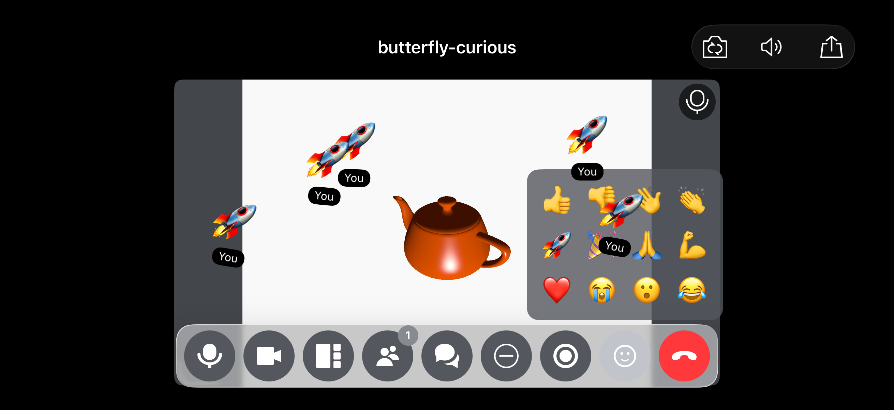

# Vonage Video API Reference App for iOS


## Welcome to Vonage

If you're new to Vonage, you can [sign up for a Vonage API account](https://dashboard.nexmo.com/sign-up?utm_source=DEV_REL&utm_medium=github&utm_campaign=vonage-video-ios-app) and get some free credit to get you started.

## What is it?

The Vonage Video API Reference App for iOS is an open-source video conferencing reference application built with the [Vonage Video API](https://developer.vonage.com/en/video/client-sdks/web/overview) and iOS SDK. It demonstrates best practices for integrating the Vonage Video API for use cases ranging from one-to-one calls to multi-participant conferencing with CallKit, screen sharing, captions, and more.

## Cross-Platform Support

The reference app is also available for:

- **Web (React)**: [vonage-video-react-app](https://github.com/Vonage/vonage-video-react-app)
- **Android**: [vonage-video-android-app](https://github.com/Vonage/vonage-video-android-app)

All three share the same backend infrastructure and demonstrate consistent best practices across platforms.

## Why use it?

The Vonage Video API Reference App for iOS provides developers an easy-to-set-up way to get started with using our APIs with the iOS SDK.

The application is open-source, so you can not only get started quickly, but easily extend it with features needed for your use case. Any features already implemented in the Reference App use best practices for scalability and security.

As a commercial open-source project, you can also count on a solid information security architecture. While no packaged solution can guarantee absolute security, the transparency that comes with open-source software, combined with the proactive and responsive open-source community and vendors, provides significant advantages in addressing information security challenges compared to closed-source alternatives.

## Features

This application provides features for common conferencing use cases, such as:

- <details>
    <summary>A landing page for users to create and join meeting rooms.</summary>
    
  </details>

- <details>
    <summary>A waiting room for users to preview their audio and video device settings and set their name before entering a meeting room.</summary>
    
  </details>
- <details>
    <summary>A post-call page to navigate users to the landing page, re-enter the left room, and display archive(s), if any.</summary>
    
  </details>

- A video conferencing “room” supporting up to 25 participants and the following features:

- <details>
    <summary>
      Configurable features: adapt the app to your specific use cases and roles.
      Configuration is handled through an <em>app-config.json</em> file in the <em>VERA/Config</em> folder. See <a href="#feature-flags">Feature Flags</a> below.
    </summary>
    
</details>

- <details>
    <summary>Call participant list with audio on/off indicator.</summary>
    
  </details>

- ShareLink integration.

- Active speaker detection.

- Start, stop and download cloud-based session recording directly from the app.

- Start and stop post-call transcription during a meeting, then download the transcript from the post-call page. Transcription runs as a separate archive, so it can run alongside a recording.

- Apply real-time background effects to the local video stream, including background blur and background replacement.

- <details>
  <summary>Display live captions for enhanced accessibility.</summary>
    
  </details>

- <details>
  <summary>Send and receive emoji reactions during a video session.</summary>
    
  </details>

- Layout manager with options to display active speaker, or all participants in a grid view.

- The dynamic display adjusts to show new joiners, hide video tiles to conserve bandwidth, and show the “next” participant when someone previously speaking leaves.

- CallKit: Helps iOS to coordinate the calling services with other apps.

- Screen sharing, enabling participants to broadcast their device screen into a Vonage video call using Apple's ReplayKit framework.

- In-call chat, allowing participants to exchange text messages during the video session.

- Settings controls, allowing participants to preconfigure publisher options in the waiting room and adjust video resolution, codec preferences, publisher settings, and call statistics during the meeting.

- Advanced noise suppression, helping reduce background noise from the local microphone during a call.

- Audio route selection, allowing users to switch the call audio output between available routes such as speaker, Bluetooth, or other system-supported devices.

## Platforms & Requirements

| Requirement | Version |
|---|---|
| iOS deployment target | 17.0+ (iOS 27 supported) |
| Xcode | 27 |
| Tuist | latest |
| SwiftLint | latest |
| SwiftFormat (swift-format) | latest |
| Git LFS | any |
| Java | 17 (Maestro E2E only) |

Core framework modules also target **macOS 14.6+** to enable fast unit-test runs without a simulator.

This app has been tested with **Vonage Video SDK 2.32** and **2.33**. Use the latest available SDK version where possible.

## Prerequisites

Install the following tools before cloning the repository:

```bash
brew install swiftlint
brew install swift-format
brew install --formula tuist
brew install git-lfs
```

> **Java 17** is also required for Maestro E2E testing. See [Testing](docs/TESTING.md) for details.

You'll also need a backend deployment and a Vonage API account — see the first step below.

## Running Locally

### 1. Deploy the backend

The app requires a running backend. Follow the setup and deployment instructions in the [vonage-video-react-app](https://github.com/Vonage/vonage-video-react-app?tab=readme-ov-file#running-locally) repository. Once the backend is deployed, note its API base URL — you'll need it in the next step.

### 2. Configure `app-config.json`

Open `VERA/Config/app-config.json` and set `baseApiUrl` to the backend URL from step 1. This is the single source of truth for the API base URL — it is required, and the build fails if it is missing or not a valid `http`/`https` URL. This is also where you toggle [feature flags](#feature-flags) and where the app's [theme](#ui-customization--theme) is configured (via the neighboring `theme.json`).

### 3. Pull Git LFS assets

```bash
git lfs pull
```

### 4. Build and run

The whole flow — prerequisites, code generation, signing, and workspace generation — is driven by a single script, **`Scripts/builder.sh`**, run from the `VERA/` directory:

```bash
cd VERA
./Scripts/builder.sh
```

On first run it walks through these phases:

1. **Check prerequisites** — Xcode, Homebrew, Python 3, Tuist.
2. **Validate configuration** — `Config/app-config.json` and `Config/theme.json` must exist. If an `app-config.json`/`theme.json` is present at the repository root, it is moved into `Config/` (overriding the default) first.
3. **Resolve base URL & environment constants** — reads the `baseApiUrl` from `app-config.json` and injects it into `EnvironmentConstants.swift`.
4. **Generate code from config and theme** — regenerates `AppConfig.swift` and the theme assets (`SemanticColors.xcassets`, `BorderRadius.swift`, `TypographyStyle.swift`).
5. **Configure code signing** — creates `Config/Signing.xcconfig` if missing, prompting for your Apple Development Team (blank is allowed).
6. **Generate workspace** — `tuist install` then `tuist generate`.
7. **Generate SPM asset accessors** — keeps the SPM build in sync with the generated asset catalog.

It then offers to build and run the app on a simulator or device, and finally asks whether to open Xcode.

Use `--update` after editing `Config/app-config.json` or `Config/theme.json` — it skips the prerequisite checks and re-runs steps 2–7:

```bash
./Scripts/builder.sh --update
```

Use `--clean-and-update` when `--update` fails because the generated workspace is stale or corrupted — it runs `tuist clean` first, then the same steps as `--update`:

```bash
./Scripts/builder.sh --clean-and-update
```

> Code generation reads `Config/app-config.json` and `Config/theme.json` **from disk**. Save any edits in your editor before running the script — unsaved changes are invisible to it.

## Environment Configuration

Code signing is controlled by `VERA/Config/Signing.xcconfig` (generated, not committed). `builder.sh` creates it for you, prompting for your Development Team. To set it non-interactively:

```bash
export DEVELOPMENT_TEAM=AB0C12DE34
export MARKETING_VERSION=1.0
export CURRENT_PROJECT_VERSION=1
./Scripts/regenerateSigningConfig.sh
```

**Where to find your Team ID:** sign in at [developer.apple.com/account](https://developer.apple.com/account) → **Membership details** → **Team ID** (a 10-character string like `A1B2C3D4E5`). This is your **Apple Developer** team, not your Vonage account.

To install on a physical device you also need to be signed in to that team in **Xcode → Settings → Accounts**. The Simulator needs neither a team nor sign-in.

See [Getting Started](docs/GETTING_STARTED.md) for the full manual, step-by-step walkthrough of environment variables and code generation.

## Feature Flags

`VERA/Config/app-config.json` controls which optional feature modules are compiled into the app. `Project.swift` reads this file when `tuist generate` runs and adds the corresponding module dependencies and Swift compilation conditions:

| `app-config.json` key | Compilation condition |
|---|---|
| `meetingRoomSettings.allowArchiving` | `ARCHIVING_ENABLED` |
| `videoSettings.allowBackgroundEffects` | `BACKGROUND_EFFECTS_ENABLED` |
| `waitingRoomSettings.allowSettings` | `SETTINGS_ENABLED` |
| `audioSettings.allowAdvancedNoiseSuppression` | `AUDIOEFFECTS_ENABLED` |
| `audioSettings.allowAudioDiagnostics` | `AUDIODIAGNOSTICS_ENABLED` |
| `meetingRoomSettings.allowFeedback` | `FEEDBACK_ENABLED` |
| `authSettings.allowAuthentication` | `AUTHENTICATION_ENABLED` |
| `"okta"` in `authSettings.idProviders` | `OKTA_ENABLED` |

Code guarded by `#if ARCHIVING_ENABLED … #endif` is only compiled when that flag is active. `DependencyContainer.swift` follows the same pattern to conditionally instantiate feature objects. Meeting-room features such as chat, captions, reactions, and screen share are always compiled via `VERAMeetingRoomSDK` and gated at runtime instead, through `DependencyContainer.meetingRoomEnabledFeatures`.

> A plain `tuist generate` does NOT regenerate the JSON-driven files. After editing `app-config.json`, always run `./Scripts/builder.sh --update`.

See [Configuration](docs/CONFIGURATION.md) for the full flag reference and [Authentication](docs/AUTHENTICATION.md) for the Okta setup.

## UI Customization / Theme

`VERA/Config/theme.json` defines design tokens — colors, typography, and border radii — for the Vonage theme, with separate light and dark variants. Running `./Scripts/builder.sh --update` converts these tokens into Xcode color assets (`SemanticColors.xcassets`, `BorderRadius.swift`, `TypographyStyle.swift`) under `VERACommonUI`.

## Working with Xcode already open

`tuist generate` rewrites the `.xcodeproj`/`.xcworkspace`. If Xcode is open when you run `--update`:

- Let Xcode reload the project if it prompts.
- **Build** again to pick up the regenerated `AppConfig.swift` / theme assets.
- If a toggled feature doesn't seem to take effect, do **Product → Clean Build Folder** and rebuild.

## Troubleshooting

| Problem | Fix |
|---|---|
| Changes to `app-config.json` not reflected | Run `./Scripts/builder.sh --update` (a plain `tuist generate` won't regenerate) |
| Stale workspace | `./Scripts/builder.sh --clean-and-update` (runs `tuist clean` then regenerates in one step) |
| `builder.sh` fails on codegen | Run the failing script directly to see the error, e.g. `python3 Scripts/generate-app-config.py` |
| SPM build fails on a missing asset (e.g. `SemanticColors.accent`) | `SPMAssets+VERACommonUI.swift` drifted from the catalog. Run `./Scripts/builder.sh --update`. Do not edit the file by hand. |
| Signing / entitlements issues | Confirm `DEVELOPMENT_TEAM` is set in `Config/Signing.xcconfig` and that you're signed in to that team in Xcode → Settings → Accounts |

Never edit `.xcodeproj`/`.xcworkspace` (generated, not committed) or files marked `DO NOT EDIT MANUALLY`.

## Documentation

| Guide | Description |
|---|---|
| [Getting Started](docs/GETTING_STARTED.md) | Manual, step-by-step prerequisites, environment setup, and first run |
| [Architecture](docs/ARCHITECTURE.md) | Project architecture, module overview, Clean Architecture layers, DI, and key patterns |
| [Authentication](docs/AUTHENTICATION.md) | Okta integration, token injection, and identity provider setup |
| [Configuration](docs/CONFIGURATION.md) | Feature flags, theme tokens, signing, and SDK version |
| [Testing](docs/TESTING.md) | Unit, snapshot, and Maestro E2E tests |
| [Localization](docs/LOCALIZATION.md) | Adding languages and working with String Catalogs |
| [Code Style](docs/CODE_STYLE.md) | SwiftLint, swift-format, and style guidelines |
| [Contributing](docs/CONTRIBUTING.md) | How to open issues, submit PRs, and branching conventions |
| [Known Issues](docs/KNOWN_ISSUES.md) | Current known issues and workarounds |

## Getting Help

- Open an issue on this repository
- Tweet at us: [@VonageDev on Twitter](https://twitter.com/VonageDev)
- [Join the Vonage Developer Community Slack](https://developer.vonage.com/community/slack)
- Email support: [support@api.vonage.com](mailto:support@api.vonage.com)

## Further Reading

- Developer documentation: <https://developer.vonage.com>
