# Vonage Video API Reference App for iOS


Open-source video conferencing reference app built on the [Vonage Video API](https://developer.vonage.com/en/video/client-sdks/web/overview) and iOS SDK, demonstrating integration patterns from one-to-one calls to multi-participant conferencing with CallKit, screen sharing, and captions.

Also available for [Web (React)](https://github.com/Vonage/vonage-video-react-app) and [Android](https://github.com/Vonage/vonage-video-android-app), sharing the same backend. New to Vonage? [Sign up for an API account](https://dashboard.nexmo.com/sign-up?utm_source=DEV_REL&utm_medium=github&utm_campaign=vonage-video-ios-app) for free credit.

## Platforms & Requirements

| Requirement | Version |
|---|---|
| iOS deployment target | 17.0+ (iOS 27 supported) |
| Xcode | 27 |
| Tuist | latest |
| SwiftLint | latest |
| SwiftFormat (swift-format) | latest |
| Git LFS | any |
| Java | 17 (Maestro E2E only) |

Core framework modules also target **macOS 14.6+** to enable fast unit-test runs without a simulator.

This app has been tested with **Vonage Video SDK 2.32** and **2.33**. Use the latest available SDK version where possible.

## Prerequisites

Install the following tools before cloning the repository:

```bash
brew install swiftlint
brew install swift-format
brew install --formula tuist
brew install git-lfs
```

> **Java 17** is also required for Maestro E2E testing. See [Testing](docs/TESTING.md) for details.

You'll also need a backend deployment and a Vonage API account — see the first step below.

## Running Locally

### 1. Deploy the backend

The app requires a running backend. Follow the setup and deployment instructions in the [vonage-video-react-app](https://github.com/Vonage/vonage-video-react-app?tab=readme-ov-file#running-locally) repository. Once the backend is deployed, note its API base URL — you'll need it in the next step.

### 2. Configure `app-config.json`

Open `VERA/Config/app-config.json` and set `baseApiUrl` to the backend URL from step 1. This is the single source of truth for the API base URL — it is required, and the build fails if it is missing or not a valid `http`/`https` URL. This is also where you toggle [feature flags](#feature-flags) and where the app's [theme](docs/CONFIGURATION.md#theme-themejson) is configured (via the neighboring `theme.json`).

### 3. Pull Git LFS assets

```bash
git lfs pull
```

### 4. Build and run

The whole flow — prerequisites, code generation, signing, and workspace generation — is driven by a single script, **`Scripts/builder.sh`**, run from the `VERA/` directory:

```bash
cd VERA
./Scripts/builder.sh
```

On first run it walks through these phases:

1. **Check prerequisites** — Xcode, Homebrew, Python 3, Tuist.
2. **Validate configuration** — `Config/app-config.json` and `Config/theme.json` must exist. If an `app-config.json`/`theme.json` is present at the repository root, it is moved into `Config/` (overriding the default) first.
3. **Resolve base URL & environment constants** — reads the `baseApiUrl` from `app-config.json` and injects it into `EnvironmentConstants.swift`.
4. **Generate code from config and theme** — regenerates `AppConfig.swift` and the theme assets (`SemanticColors.xcassets`, `BorderRadius.swift`, `TypographyStyle.swift`).
5. **Configure code signing** — creates `Config/Signing.xcconfig` if missing, prompting for your Apple Development Team (blank is allowed).
6. **Generate workspace** — `tuist install` then `tuist generate`.
7. **Generate SPM asset accessors** — keeps the SPM build in sync with the generated asset catalog.

It then offers to build and run the app on a simulator or device, and finally asks whether to open Xcode.

#### Feature Flags

`VERA/Config/app-config.json` also controls which optional feature modules are compiled into the app — this is what phase 2 (validate configuration) and phase 4 (generate code) of `builder.sh` above actually read. See [Configuration](docs/CONFIGURATION.md) for the full flag reference and [Authentication](docs/AUTHENTICATION.md) for the Okta setup.

Use `--update` after editing `Config/app-config.json` or `Config/theme.json` — it skips the prerequisite checks and re-runs steps 2–7:

```bash
./Scripts/builder.sh --update
```

Use `--clean-and-update` when `--update` fails because the generated workspace is stale or corrupted — it runs `tuist clean` first, then the same steps as `--update`:

```bash
./Scripts/builder.sh --clean-and-update
```

> Code generation reads `Config/app-config.json` and `Config/theme.json` **from disk**. Save any edits in your editor before running the script — unsaved changes are invisible to it.

`tuist generate` rewrites the `.xcodeproj`/`.xcworkspace`, so if Xcode is already open when you run `--update`: let it reload the project if it prompts, then **Build** again to pick up the regenerated `AppConfig.swift` / theme assets. If a toggled feature doesn't seem to take effect, do **Product → Clean Build Folder** and rebuild.

## Features

Vonage Video SDK capabilities this app demonstrates, grouped the same way as the cross-platform [VERA feature matrix](https://api.support.vonage.com/hc/en-us/articles/25623618204444-What-is-the-Vonage-Video-Reference-App). Screenshots are filled in as they become available.

| Category | Feature | Description | Screenshot |
|---|---|---|---|
| Core | Basic Audio/Video | Join a call with camera and microphone enabled. | 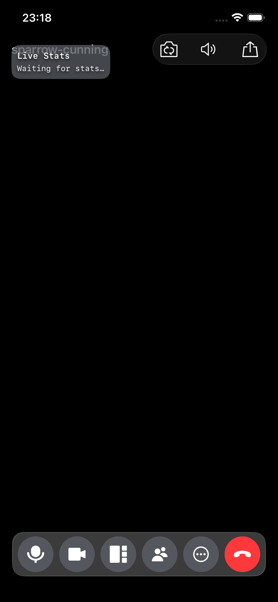 |
| Core | Mute/Unmute | Toggle the local microphone during a call. | 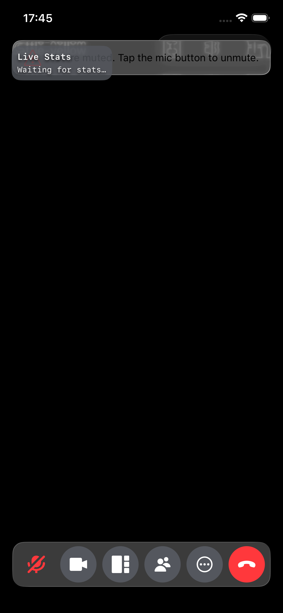 |
| Core | Screen Sharing | Broadcast your device screen into the call using ReplayKit. | — |
| Core | Text Chat | Exchange text messages with other participants during a session. | 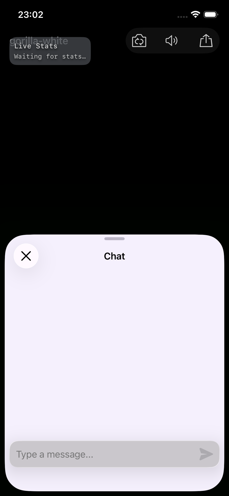 |
| Pre-Call | Waiting Room | Preview your camera and microphone and set your name before joining. | 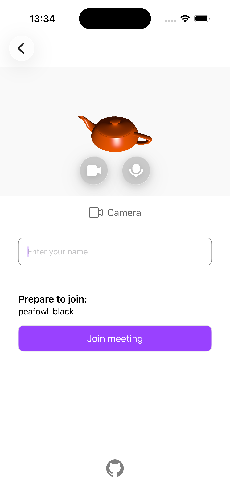 |
| Participant Management | Participant List | View everyone in the call with an audio on/off indicator. | 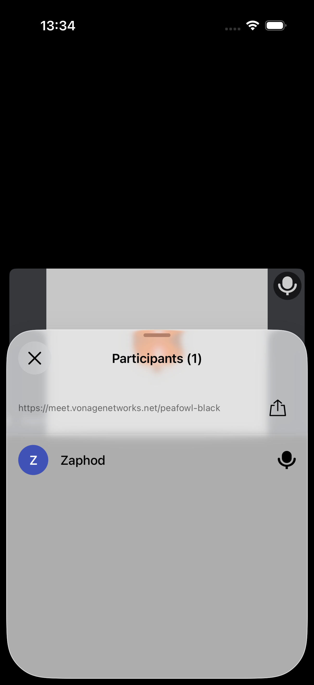 |
| Reactions | Reactions (emoji) | Send and receive emoji reactions during a session. |  |
| Background & Effects | Background Blur | Blur the background behind the local participant in real time. | 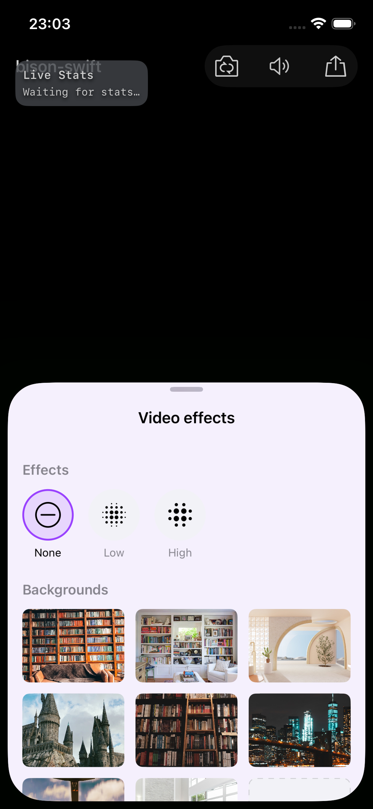 |
| Background & Effects | Background Replacement | Replace the background with an image in real time. |  |
| Captions & Accessibility | Live Captions | Real-time speech-to-text captions during the call. | 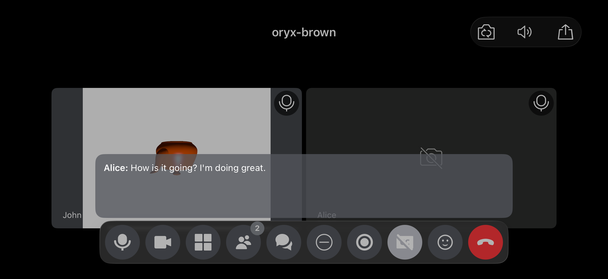 |
| Captions & Accessibility | Post-call Transcription | Start/stop transcription independently of recording; download the transcript after the call. | 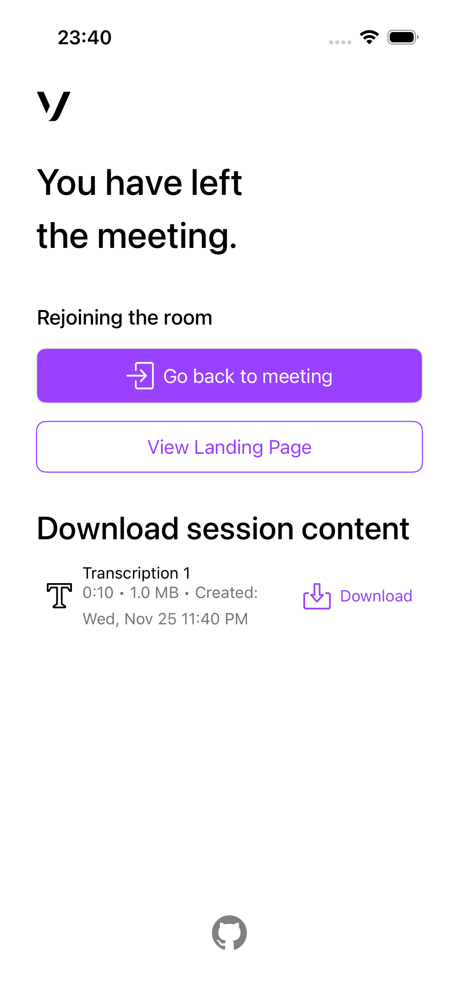 |
| Recording | Archiving (Cloud Recording) | Start, stop, and download cloud-based session recordings. | 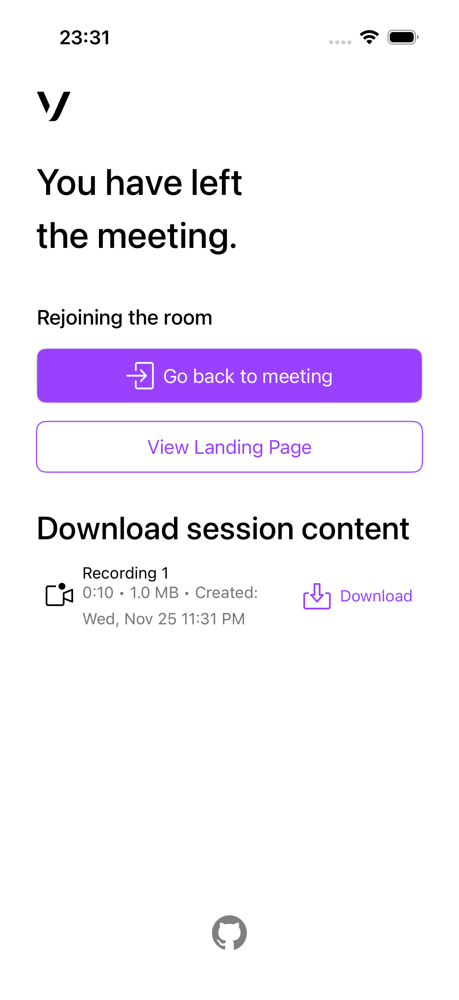 |
| Audio | Noise Suppression | Reduce background noise from the local microphone during a call. | 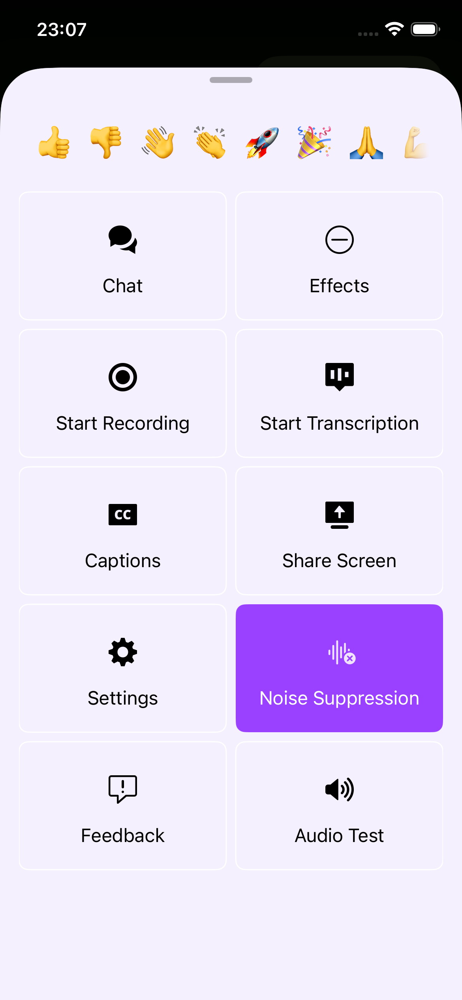 |
| Audio | Audio Route Selection | Switch call audio output between speaker, Bluetooth, and other routes. | 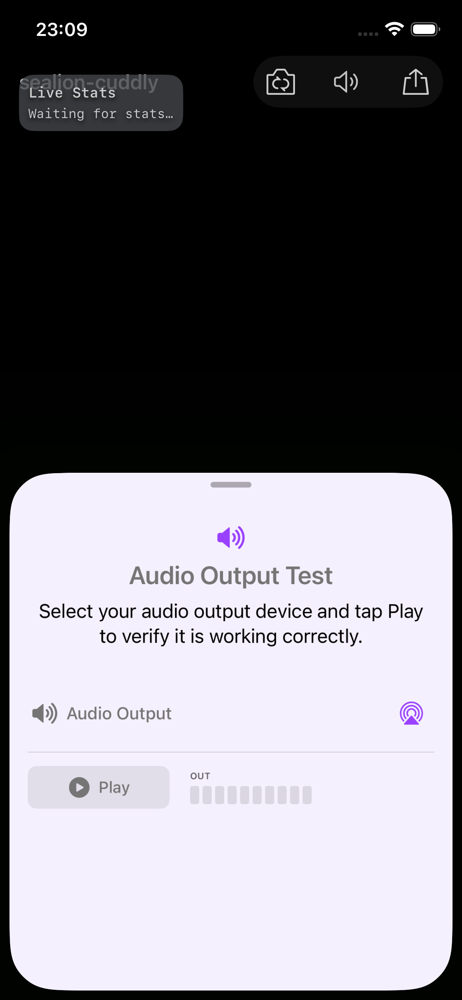 |

## Documentation

| Guide | Description |
|---|---|
| [Getting Started](docs/GETTING_STARTED.md) | Manual, step-by-step prerequisites, environment setup, and first run |
| [Architecture](docs/ARCHITECTURE.md) | Project architecture, module overview, Clean Architecture layers, DI, and key patterns |
| [Authentication](docs/AUTHENTICATION.md) | Okta integration, token injection, and identity provider setup |
| [Configuration](docs/CONFIGURATION.md) | Feature flags, theme tokens, signing, and SDK version |
| [Testing](docs/TESTING.md) | Unit, snapshot, and Maestro E2E tests |
| [Localization](docs/LOCALIZATION.md) | Adding languages and working with String Catalogs |
| [Code Style](docs/CODE_STYLE.md) | SwiftLint, swift-format, and style guidelines |
| [Contributing](docs/CONTRIBUTING.md) | How to open issues, submit PRs, and branching conventions |
| [Known Issues](docs/KNOWN_ISSUES.md) | Current known issues and workarounds |

## Getting Help

- Open an issue on this repository
- Tweet at us: [@VonageDev on Twitter](https://twitter.com/VonageDev)
- [Join the Vonage Developer Community Slack](https://developer.vonage.com/community/slack)
- Email support: [support@api.vonage.com](mailto:support@api.vonage.com)

## Further Reading

- Developer documentation: <https://developer.vonage.com>
