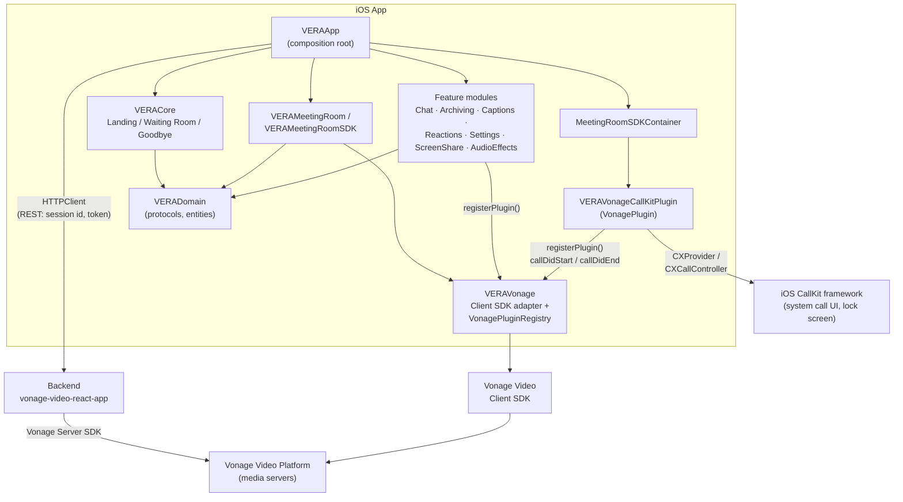

# Architecture

The Vonage Video iOS Reference App is organized as a multi-module Xcode workspace managed entirely by [Tuist](https://tuist.dev). This document describes the project architecture, module overview, Clean Architecture layers used within each module, and the key design patterns.

## Project Architecture

This reference app requires the user to deploy a backend and then use the backend API URL as the base URL in the `DependencyContainer.swift` file of the VERAApp module. You can find backend code and deployment instructions in the [vonage-video-react-app](https://github.com/Vonage/vonage-video-react-app) repository.

The backend communicates with the Vonage Video platform using the Vonage Server SDK and is responsible for generating the session IDs and tokens used to connect to video rooms through the Vonage Client SDK.



The iOS app never talks to the Vonage Video platform directly for session setup: it asks the backend for a session ID and token over REST, then uses the Vonage Video Client SDK (wrapped by `VERAVonage`) to connect to the platform's media servers with those credentials. The backend is the only component that holds Vonage Server SDK credentials.

### What CallKit does in VERA

[CallKit](https://developer.apple.com/documentation/callkit) is Apple's framework for apps that place or receive calls, so the system can treat them like phone calls instead of generic background activity. In VERA, `VERAVonageCallKitPlugin` uses it to:

- **Show the call on the lock screen and in Recents**, with native hold/mute/end controls, instead of only inside the app's own UI.
- **Put the audio session into "Calling Services" mode** (`OTAudioSessionManager`), the same category Phone/FaceTime use, so routing, interruptions, and Bluetooth behave like a real call.
- **Coordinate with other calls on the device** — if a phone call comes in during a Vonage session, iOS (not VERA) decides how to handle the conflict, because the app registered itself as a real call.
- **Keep mute state in sync both ways**: muting from the in-app button updates the system call UI, and muting from the lock screen or a connected headset updates the app's call state (`CallKitMuteSynchronizer` filters out the echo of VERA's own updates so the two don't fight each other).

`VERAVonageCallKitPlugin` is wired exactly like every other feature plugin — `MeetingRoomSDKContainer` (built via `MeetingRoomBuilder`) registers it on the same `VonagePluginRegistry` inside `VERAVonage`, and it receives the same `callDidStart(_:)` / `callDidEnd()` lifecycle callbacks. What makes it different is the other side: instead of only talking to Vonage, it also bridges to the native **CallKit** framework (`CXProvider` / `CXCallController`) to drive the system call UI, lock-screen controls, and mute synchronization. `DependencyContainer.isCallKitSupported` is hardcoded `false` on the Simulator and `true` on device, so the plugin is never registered when running on Simulator — see `VonageCallKitPlugin.setup()`'s own warning that `OTPublisher` fails to connect if CallKit is active there.

## Module Overview

The Vonage iOS reference app is built with a modular architecture. The app is organized into the following frameworks:

- **VERAApp**: Main application target and composition root.
- **VERACore**: Landing, waiting room, goodbye, and shared app flows.
- **VERAMeetingRoom**: Main meeting room UI and call experience.
- **VERAMeetingRoomSDK**: Prebuilt meeting room SDK exposed through `MeetingRoomBuilder`.
- **VERADomain**: Shared protocols, entities, value types, and SDK-independent contracts.
- **VERAConfiguration**: Generated app configuration model from `app-config.json`.
- **VERACommonUI**: Shared SwiftUI components, resources, and theme assets.
- **VERAVonage**: Vonage Video SDK adapter layer and active speaker tracking.
- **VERAChat**: In-call chat UI, domain, and data layer.
- **VERAArchiving**: Cloud recording and post-call transcription controls, and the goodbye page's session content list (recording and transcript downloads).
- **VERABackgroundEffects**: Background blur and video effect support.
- **VERACaptions**: Live captions UI and captions state handling.
- **VERAReactions**: Emoji reaction picker and floating reaction overlay.
- **VERASettings**: In-call settings, publisher configuration, and stats UI.
- **VERAScreenShare**: Screen sharing UI and credential storage support.
- **VERAAudioEffects**: Advanced noise suppression integration.
- **VERAFeedback**: Feedback UI and standalone demo support.
- **VERAE2E**: Deterministic E2E mocks and test support for Maestro flows.
- **VERALogger**: Shared logging abstractions and strategies.
- **VERACocoaLumberjackLogger**: CocoaLumberjack-backed logger implementation.
- **VERAVonageCallKitPlugin**: CallKit integration plugin.
- **VERAVonageChatPlugin**: Chat signal integration plugin.
- **VERAVonageArchivingPlugin**: Archiving SDK/backend integration plugin.
- **VERAVonageCaptionsPlugin**: Captions integration plugin.
- **VERAVonageReactionsPlugin**: Reactions signal integration plugin.
- **VERAVonageSettingsPlugin**: Settings and network stats integration plugin.
- **VERAVonageScreenSharePlugin**: Screen sharing integration plugin, including the broadcast extension target.

## Module Graph

```
VERAApp              – Composition root; DependencyContainer wires all modules together
VERADomain           – Shared protocols, entities, and value types (no SDK imports)
VERACore             – Main UI + business logic (Landing, WaitingRoom, GoodBye flows)
VERAMeetingRoom      – Meeting room feature; depends on VERADomain + VERACommonUI
VERAVonage           – Vonage Video SDK adapter layer + ActiveSpeakerTracker
VERACommonUI         – Shared SwiftUI components and theme assets
VERAConfiguration    – AppConfig model generated from app-config.json
```

### Optional Feature Modules

These modules are compiled only when the corresponding feature flag is enabled in `app-config.json` (see [Configuration](CONFIGURATION.md)):

| Module | Plugin |
|---|---|
| VERAChat | VERAVonageChatPlugin |
| VERAArchiving | VERAVonageArchivingPlugin |
| VERABackgroundEffects | — |
| VERACaptions | VERAVonageCaptionsPlugin |
| VERAReactions | VERAVonageReactionsPlugin |
| VERASettings | VERAVonageSettingsPlugin |
| VERAScreenShare | VERAVonageScreenSharePlugin |
| VERAAudioEffects | — |
| VERAVonageCallKitPlugin | — (always included) |

## Layer Structure within Modules

Feature modules follow Clean Architecture with a strict dependency rule — inner layers never depend on outer layers.

```
Domain/              ← Innermost layer (pure business logic, no framework imports)
  Entities/          – Value types, domain models
  Repositories/      – Protocol definitions (interfaces only)
  DataSources/       – Protocol definitions for data access
  Services/          – Domain service protocols
  Use cases/         – Application-specific business rules

Data/                ← Outer layer (implements Domain protocols)
  Repositories/      – Concrete repository implementations
  DataSources/       – HTTP, UserDefaults, or in-memory data sources
  Mappers/           – DTO ↔ domain model mapping

UI/                  ← Outer layer (presentation)
  View/              – SwiftUI views (*Screen coordinator + *View stateless)
  View models/       – @MainActor ObservableObject classes
  Components/        – Screen-specific reusable UI components

Utils/               – Helper extensions and utilities (optional)
Wireframe/           – Factory classes that wire Domain + Data + UI together
```

**Dependency rule:**
- `Domain/` must **not** import anything from `Data/`, `UI/`, or `Wireframe/`.
- `Data/` depends on `Domain/` but never on `UI/`.
- `UI/` depends on `Domain/` but never on `Data/` directly.
- `Wireframe/` is the composition point — it knows all layers and wires concrete `Data/` implementations into `Domain/` protocol slots consumed by `UI/` view models.

## Dependency Injection

`DependencyContainer` in `VERAApp` is the single composition root. All repositories, use cases, and plugins are lazy properties instantiated here. No other module creates concrete dependencies — all inter-module communication goes through protocols defined in `VERADomain`.

## Plugin Pattern

Optional features integrate with the Vonage session through the `VonagePlugin` protocol (`VonagePluginCallLifeCycle & VonagePluginID`). Plugins are registered on `VonagePluginRegistry` inside `DependencyContainer` and are passed to `VonageSessionRepository`. They receive `callDidStart(_:)` / `callDidEnd()` lifecycle callbacks and can hold a `VonageSignalChannel` to emit signals.

## Screen Construction (Factory / Wireframe Pattern)

Each flow uses a `XxxFactory` class (in a `Wireframe/` folder) that constructs the `ViewModel` and the SwiftUI `View` as a pair:

```swift
let (view, viewModel) = meetingRoomFactory.make(roomName:getExternalButtons:onActionHandler:)
```

Factories receive all dependencies through their initializer from `DependencyContainer`.

## Multi-Platform Targets

Core framework modules (`VERACore`, `VERAMeetingRoom`, `VERADomain`, `VERACommonUI`, `VERAConfiguration`, `VERASettings`, `VERAScreenShare`) target both **iOS 17+** and **macOS 14.6+**, enabling fast unit-test runs on macOS without a simulator.

iOS-only modules include anything using the Vonage SDK, UIKit, or VonageVideoTransformers (e.g., `VERAVonage`, `VERAAudioEffects`, all plugin modules).

## BroadcastExtension (Screen Sharing)

`VERAVonageScreenSharePlugin` includes a `BroadcastExtension` app extension target that uses ReplayKit's Broadcast Upload Extension API. The extension source lives in `VERAApp/BroadcastExtension/`.

## Backend Integration

The app requires a running backend for session management. The backend communicates with the Vonage Video platform using the Vonage Server SDK and generates session IDs and tokens. See [vonage-video-react-app](https://github.com/Vonage/vonage-video-react-app) for backend deployment instructions.
